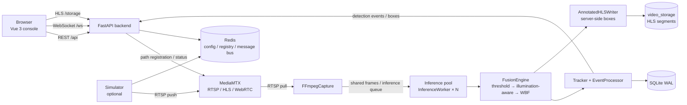

# FireGuard — Intelligent Fire Monitoring Platform

[](LICENSE)
[](backend/requirements.txt)
[](frontend/package.json)
[](backend/requirements.txt)

FireGuard is a deep-learning-based fire and smoke monitoring platform. It supports image, video file,
and live stream detection tasks, improves detection through multi-model fusion and RGB/IR dual-spectrum
analysis, and provides a web console for task management, model management, live monitoring, history
playback, and detection event review.

This repository is the open-source fixed release. It contains the complete source code and deployment
instructions. Runtime dependencies (FFmpeg, MediaMTX, Redis), detection models, and runtime data are
not distributed with the repository.

---

## Table of Contents

- [Features](#features)
- [Architecture](#architecture)
- [Tech Stack](#tech-stack)
- [Repository Layout](#repository-layout)
- [Requirements](#requirements)
- [Installation](#installation)
- [Running the Services](#running-the-services)
- [Ports](#ports)
- [Server Deployment](#server-deployment)
- [Configuration](#configuration)
- [Detection Models](#detection-models)
- [Data and Logs](#data-and-logs)
- [Troubleshooting](#troubleshooting)
- [License](#license)

---

## Features

### Detection and fusion

- **Three task types**: image (`image`), video file (`video`), and live stream (`stream`). Each task can use multiple detection models.
- **Multi-model fusion**: threshold pre-filter → illumination-aware weighting → weighted box fusion (WBF). Each model has its own weight, class thresholds, and enabled classes.
- **RGB / IR dual spectrum**: visible-light and thermal inputs are aligned by timestamp. IR model weight increases automatically in low light.
- **ONNX inference**: ONNX Runtime on CPU or NVIDIA CUDA. Supports YOLO-family models, RT-DETR, and custom models that follow the output contract.
- **Elastic inference pool**: inference processes scale with CPU load. Each model runs in its own worker process to avoid blocking other models.
- **Tracking and events**: Enter/Leave events are generated from detection boxes and written only on state changes, reducing database load.

### Streaming and monitoring

- **Multi-protocol ingest**: RTSP, RTMP, and HTTP streams. Standard RTSP cameras (Hikvision, Dahua, Uniview, etc.) and ONVIF discovery are supported.
- **Media gateway**: MediaMTX provides RTSP, HLS, and WebRTC, with dynamic path registration and lifecycle management.
- **Server-rendered detection boxes**: boxes are drawn into the HLS picture by the backend, keeping playback and detection events frame-accurate without frontend canvas overlays.
- **Live monitoring and history playback**: multi-channel grid, live HLS playback, seekable history playback, and a detection event timeline.
- **Resumable recording**: HLS segments and playlists are preserved when a stream task stops. The next run continues from the previous checkpoint without overwriting history.
- **Hardware acceleration**: FFmpeg capture supports NVIDIA NVDEC, Intel QSV, and AMD AMF, with CPU fallback.

### Platform

- **Model management**: upload `.onnx` models, maintain metadata, configure label mapping and per-class thresholds.
- **Task management**: create, start, pause, stop, and delete tasks; inspect status, results, and logs.
- **Authentication and security**: JWT login, bcrypt password hashing, rate limiting, storage quotas, and upload size limits.
- **Stream simulator**: publish local video files as RTSP streams when no camera is available.
- **DVR / VOD**: live recordings, history segments, and result snapshots are stored on disk and can be replayed per task.

---

## Architecture



### Main modules

| Module | Responsibility |
|--------|----------------|
| `backend/app/task_runner.py` | Task lifecycle, model worker scheduling, image/video/stream dispatch |
| `backend/app/services/video_stream.py` | Stream capture, inference scheduling, box injection, HLS writing |
| `backend/app/services/fusion_engine.py` | Three-stage fusion: threshold filter, illumination-aware weighting, WBF |
| `backend/app/services/detector.py` | ONNX model loading, inference, and post-processing |
| `backend/app/services/inference_worker.py` | Standalone inference process consuming frame queues |
| `backend/app/services/ffmpeg_capture.py` | FFmpeg subprocess capture with resolution and frame-rate normalization |
| `backend/app/services/storage_manager.py` | HLS recording, history segments, result snapshots |
| `backend/app/services/media_server.py` | MediaMTX startup, port allocation, health checks, takeover |
| `backend/app/services/registry.py` | Redis-backed configuration center and service registry |
| `simulator/` | Local video → RTSP stream simulator for testing without a camera |

### Detection data flow

1. A camera or the simulator pushes RTSP/RTMP to MediaMTX.
2. The backend pulls the stream per task; FFmpegCapture decodes it into normalized RGB/IR frames.
3. Frames enter shared memory and inference queues, then are processed by the worker for each model.
4. FusionEngine applies threshold filtering, illumination-aware weighting, and WBF.
5. Tracker generates Enter/Leave events, writes them to SQLite, and pushes them to the frontend over WebSocket.
6. AnnotatedHLSWriter draws boxes onto frames and encodes HLS. The player and event timeline stay in sync.

---

## Tech Stack

| Layer | Technology | Verified version |
|-------|------------|------------------|
| Frontend | Vue 3, TypeScript, Vite, Ant Design Vue, Pinia, Vue Router, hls.js | Vue 3.3 / Vite 5 / Node.js 22.14.0 |
| Backend | Python, FastAPI, Uvicorn, Pydantic v2, SQLModel | Python 3.13.1 / FastAPI 0.136.1 |
| Inference | ONNX Runtime, OpenCV, NumPy | ONNX Runtime 1.20.0 / OpenCV 4.13 |
| Streaming | FFmpeg, MediaMTX | FFmpeg 6.1.1 / MediaMTX 1.18.1 |
| Data | SQLite (WAL), Redis | Redis 5.0.14.1 (bundled Windows build) |
| Auth | JWT (python-jose), bcrypt (passlib), SlowAPI | - |

> Python 3.10+ and Node.js 18+ are supported. The versions above are the environment used for this release.

---

## Repository Layout

```text
FireGuard/
├── backend/
│   ├── app/
│   │   ├── main.py                 # FastAPI entry, WebSocket, HLS static serving
│   │   ├── config.py               # Environment and runtime configuration
│   │   ├── database.py             # SQLite initialization and migration
│   │   ├── dependencies.py         # JWT, password hashing, current user
│   │   ├── limiter.py              # Rate limiting
│   │   ├── models/                 # SQLModel data models
│   │   ├── routers/                # auth / models / tasks routes
│   │   ├── schemas/                # Request and response schemas
│   │   ├── services/               # Detection, fusion, streaming, storage
│   │   └── utils/                  # Logging, clock, shared memory, hardware
│   ├── tests/                      # pytest suite
│   ├── data/                       # Runtime data (uploads, models, results, recordings)
│   ├── logs/                       # Backend logs
│   ├── requirements.txt            # CPU dependencies
│   ├── requirements-gpu.txt        # NVIDIA CUDA dependencies
│   ├── requirements-dev.txt        # Test and development dependencies
│   ├── .env.example                # Environment template
│   └── run_backend.bat             # Windows launcher
├── frontend/
│   ├── src/
│   │   ├── api/                    # Axios API clients
│   │   ├── components/             # Player, detection config, event panel
│   │   ├── router/                 # Routes
│   │   ├── stores/                 # Pinia stores
│   │   ├── utils/                  # Frontend logging
│   │   └── views/                  # Login, tasks, models, monitoring
│   ├── package.json
│   └── vite.config.ts
├── simulator/                      # RTSP stream simulator
├── bin/                            # Runtime dependency directory (place FFmpeg / MediaMTX / Redis here)
└── README.md
```

---

## Requirements

### Hardware

| Component | Minimum | Recommended |
|-----------|---------|-------------|
| CPU | 4 cores | 8 cores or more |
| Memory | 8 GB | 16 GB or more |
| Disk | 10 GB free | SSD, 50 GB or more |
| GPU | None (CPU inference) | NVIDIA GPU with at least 4 GB VRAM |

### Software

| Software | Version | Purpose | Required |
|----------|---------|---------|----------|
| Python | 3.10+ | Backend and simulator | Yes |
| Node.js | 18+ | Frontend build and dev server | Yes |
| FFmpeg / FFprobe | 4.0+ (tested 6.1.1) | Decoding, transcoding, HLS | Yes |
| MediaMTX | 1.18+ (tested 1.18.1) | RTSP / HLS / WebRTC gateway | Yes, for live streaming |
| Redis | 5.0+ (tested 5.0.14.1) | Config center, registry, message bus | Recommended (falls back to in-memory) |
| NVIDIA driver / CUDA | Driver ≥ 525.60, CUDA 12.1, cuDNN 9.1 | GPU inference | Optional |

> This open-source repository does not bundle FFmpeg, MediaMTX, or Redis. Prepare them as described
> under Installation → Runtime dependencies. On Windows, place the binaries under `bin/` and the
> backend starts them automatically.

---

## Installation

### 1. Python virtual environment

```bash
cd backend

python -m venv .venv

# Windows
.venv\Scripts\activate
# Linux / macOS
source .venv/bin/activate
```

Install backend dependencies:

```bash
# CPU
pip install -r requirements.txt

# NVIDIA GPU (CUDA 12.1)
pip install -r requirements-gpu.txt

# Development and tests (optional)
pip install -r requirements-dev.txt
```

### 2. Frontend dependencies

```bash
cd frontend
npm install
```

### 3. Runtime dependencies (FFmpeg / MediaMTX / Redis)

#### Windows

This repository does not include the binaries. Place the following files under `bin/`:

```text
bin/
├── ffmpeg.exe
├── ffprobe.exe
├── mediamtx.exe
├── mediamtx.yaml
└── redis/
    ├── redis-server.exe
    ├── redis-cli.exe
    └── redis.windows.conf
```

Download links:

- FFmpeg (Windows builds): <https://www.gyan.dev/ffmpeg/builds/>
- MediaMTX: <https://github.com/bluenviron/mediamtx/releases> (v1.18.1 recommended)
- Redis for Windows: <https://github.com/tporadowski/redis/releases> (5.0.14 recommended)

After placing the files under `bin/`, the backend starts Redis and MediaMTX automatically; no manual
startup is needed.

#### Linux / macOS

```bash
# Ubuntu / Debian
sudo apt update
sudo apt install -y python3 python3-venv python3-pip ffmpeg redis-server

# Start Redis
sudo systemctl enable --now redis-server
```

The backend looks for `bin/mediamtx.exe` by default. On Linux, place the MediaMTX binary at that path
(the file name can stay as-is; the binary is executed directly):

```bash
wget https://github.com/bluenviron/mediamtx/releases/download/v1.18.1/mediamtx_v1.18.1_linux_amd64.tar.gz
tar -xzf mediamtx_v1.18.1_linux_amd64.tar.gz
sudo install -m 755 mediamtx /opt/FireGuard/bin/mediamtx.exe
```

Alternatively, create a symlink:

```bash
ln -s /usr/local/bin/mediamtx bin/mediamtx.exe
```

> On Linux, the backend does not start Redis automatically. Use the system Redis service; if it is
> unavailable, the message bus falls back to in-memory mode.

### 4. Environment variables

```bash
cd backend

# Windows
copy .env.example .env
# Linux / macOS
cp .env.example .env
```

Edit `backend/.env` and set at least `SECRET_KEY`:

```bash
python -c "import secrets; print(secrets.token_hex(32))"
```

```ini
SECRET_KEY=<generated-random-string>
```

> `.env` is excluded by `.gitignore`; do not commit it.

---

## Running the Services

### 1. Start the backend

```bash
cd backend

# Generic command
python -m uvicorn app.main:app --host 0.0.0.0 --port 8000 --reload
```

On Windows, you can also run:

```bat
backend\run_backend.bat
```

After startup:

- Health check: <http://localhost:8000/api/health>
- API docs: <http://localhost:8000/api/docs> (disabled when `FIREGUARD_MODE=production`)

The backend automatically:

1. Connects to Redis (on Windows, starts the bundled build if present and port 6379 is free);
2. Initializes the config center and registers the backend service;
3. Initializes the SQLite database with WAL mode;
4. Starts MediaMTX when a binary is present under `bin/`;
5. Starts the inference pool and task scheduler.

### 2. Start the frontend

```bash
cd frontend
npm run dev
```

Open <http://localhost:5173>. The dev server proxies `/api`, `/ws`, and `/storage` to `http://127.0.0.1:8000`.

> To access the dev server from another machine, run `npm run dev -- --host 0.0.0.0`.

### 3. Start the simulator (optional)

If no camera is available, publish local video files as RTSP streams:

```bash
cd simulator

# Reuse the backend virtual environment, or create a separate one
pip install -r requirements.txt

python -m uvicorn main:app --host 0.0.0.0 --port 8001
```

Console: <http://localhost:8001>

The simulator uses separate MediaMTX ports (RTSP 8555 / API 9996) and does not conflict with the backend.

### 4. First use

1. Open <http://localhost:5173>, register an account (username 2–50 characters, password at least 6 characters).
2. Go to **Model Management**, upload an `.onnx` model, and configure label mapping.
3. Go to **Task Management**, create an image, video, or stream task, and bind one or more models.
4. Start the task and open **Live Monitoring** to view the picture, boxes, and detection events.
5. Without a camera, upload a video in the simulator, start its RTSP stream, and use
   `rtsp://127.0.0.1:8555/<stream_path>` as the source.

### 5. Production frontend build

```bash
cd frontend
npm run build
```

The output is written to `frontend/dist/` and can be served by Nginx or any static file server.

---

## Ports

| Service | Default port | Address | Description |
|---------|--------------|---------|-------------|
| Backend API | 8000 | <http://localhost:8000> | FastAPI service |
| Frontend dev server | 5173 | <http://localhost:5173> | Vite |
| Simulator console | 8001 | <http://localhost:8001> | Simulated stream management |
| Redis | 6379 | `localhost:6379` | Config center / message bus |
| MediaMTX RTSP | 8554 | `rtsp://localhost:8554` | Backend RTSP ingest/playback |
| MediaMTX HLS | 8888 | <http://localhost:8888> | HLS playback |
| MediaMTX WebRTC | 8889 | - | WebRTC playback |
| MediaMTX API | 9997 | <http://localhost:9997> | Stream path management |
| Simulator RTSP | 8555 | `rtsp://localhost:8555` | Separate simulator gateway |
| Simulator API | 9996 | <http://localhost:9996> | Simulator gateway management |

> Ports can be changed with the `MEDIAMTX_*` variables in `backend/.env`. Update firewall and reverse
> proxy rules after changing them.

---

## Server Deployment

The example below targets Ubuntu 22.04 / Debian 12 with the application installed at `/opt/FireGuard`.

### 1. System dependencies

```bash
sudo apt update
sudo apt install -y python3 python3-venv python3-pip ffmpeg redis-server nginx
sudo systemctl enable --now redis-server
```

Place MediaMTX at `bin/mediamtx.exe` (see above), or run MediaMTX as a separate systemd service.

### 2. Backend systemd service

```ini
# /etc/systemd/system/fireguard-backend.service
[Unit]
Description=FireGuard Backend
After=network.target redis-server.service

[Service]
Type=simple
WorkingDirectory=/opt/FireGuard/backend
EnvironmentFile=/opt/FireGuard/backend/.env
ExecStart=/opt/FireGuard/backend/.venv/bin/python -m uvicorn app.main:app --host 0.0.0.0 --port 8000
Restart=always
RestartSec=5

[Install]
WantedBy=multi-user.target
```

```bash
sudo systemctl daemon-reload
sudo systemctl enable --now fireguard-backend
sudo systemctl status fireguard-backend
```

Recommended `backend/.env` settings:

```ini
FIREGUARD_MODE=production
SECRET_KEY=<your-random-secret>
ALLOWED_ORIGINS=https://your-domain.example
```

In production mode, `/api/docs` and `/api/redoc` are disabled.

### 3. Frontend Nginx configuration

```nginx
server {
    listen 80;
    server_name fireguard.example.com;

    root /opt/FireGuard/frontend/dist;
    index index.html;
    client_max_body_size 2g;

    location / {
        try_files $uri $uri/ /index.html;
    }

    location /api/ {
        proxy_pass http://127.0.0.1:8000;
        proxy_set_header Host $host;
        proxy_set_header X-Real-IP $remote_addr;
        proxy_read_timeout 600s;
    }

    location /ws/ {
        proxy_pass http://127.0.0.1:8000;
        proxy_http_version 1.1;
        proxy_set_header Upgrade $http_upgrade;
        proxy_set_header Connection "upgrade";
        proxy_set_header Host $host;
        proxy_read_timeout 3600s;
    }

    location /storage/ {
        proxy_pass http://127.0.0.1:8000;
        proxy_set_header Host $host;
    }
}
```

```bash
sudo nginx -t
sudo systemctl reload nginx
```

### 4. Network and security

- Expose only 80/443. Keep the backend (8000), Redis (6379), and MediaMTX API (9997) on the internal network.
- If cameras push directly to the server, allow RTSP 8554.
- Use HTTPS in production. WebSocket connections will use `wss://` automatically.
- Back up `backend/data/` and `backend/.env` regularly.

---

## Configuration

See `backend/.env.example` and `backend/app/config.py` for the full list.

| Variable | Default | Description |
|----------|---------|-------------|
| `SECRET_KEY` | None (required) | JWT signing key; the backend refuses to start without it |
| `FIREGUARD_MODE` | `development` | `development` / `production` / `simulator` |
| `ACCESS_TOKEN_EXPIRE_MINUTES` | `1440` | Access token lifetime |
| `MAX_CONCURRENT_TASKS` | `4` | Maximum concurrent tasks |
| `MAX_STORAGE_BYTES` | `21474836480` | Total storage quota (20 GB) |
| `MAX_FILE_SIZE_BYTES` | `21474836480` | Per-file size limit |
| `MAX_UPLOAD_SIZE_MB` | `20480` | Upload size limit (MB) |
| `DETECTION_FPS_STREAM` | `15` | Stream inference FPS cap |
| `DETECTION_FPS_VIDEO` | `5` | Video inference FPS |
| `DETECTION_FPS_IMAGE` | `10` | Image inference FPS |
| `USE_GPU` | `False` | Enable GPU inference |
| `GPU_DEVICE_ID` | `0` | GPU index |
| `HW_ACCEL_DECODER` | `auto` | `auto` / `nvenc` / `qsv` / `amf` / `cpu` |
| `REDIS_URL` | `redis://localhost:6379/0` | Redis connection string |
| `ALLOWED_ORIGINS` | Local dev origins | CORS allow-list, comma-separated |
| `MEDIAMTX_RTSP_PORT` | `8554` | RTSP port |
| `MEDIAMTX_HLS_PORT` | `8888` | HLS port |
| `MEDIAMTX_API_PORT` | `9997` | MediaMTX control API port |
| `FFMPEG_PATH` / `FFPROBE_PATH` | Auto-detect | Explicit executable paths |

> Values in `.env.example` are examples; adjust them for your hardware and workload.

---

## Detection Models

Model files are not distributed with this repository. Prepare your own trained ONNX models and upload
them in **Model Management** (only `.onnx` is supported).

### Input and output contract

- **Input**: `[1, 3, H, W]` float tensor, RGB order, normalized to `0..1`.
- **Output**: `[1, N, 5 + C]`. Each box is
  `[cx, cy, w, h, objectness, class_score_1, ..., class_score_C]`,
  with coordinates in input-image pixels.
- **Compatible models**: YOLO family, RT-DETR, and custom models that follow the contract above.
- Class names can be configured under **Model Management → Label Mapping**.

### GPU inference

1. Install an NVIDIA driver (≥ 525.60) and CUDA 12.1 / cuDNN 9.1.
2. Run `pip install -r backend/requirements-gpu.txt`.
3. Set `USE_GPU=True` in `backend/.env`.
4. Verify:

```bash
python -c "import onnxruntime; print(onnxruntime.get_available_providers())"
```

The output should include `CUDAExecutionProvider`.

---

## Data and Logs

| Path | Content |
|------|---------|
| `backend/data/fire_detection.db` | SQLite database (tasks, models, events, records) |
| `backend/data/uploads/` | Uploaded images and videos |
| `backend/data/models/` | Registered ONNX model files |
| `backend/data/results/` | Image detection results and snapshots |
| `backend/data/video_storage/` | HLS recordings, live, and history segments |
| `backend/logs/` | Backend logs |
| `simulator/data/uploads/` | Videos uploaded to the simulator |
| `simulator/data/logs/` | Simulator and MediaMTX logs |

These directories are excluded by `.gitignore`. When migrating or backing up, include `backend/data/`
and `backend/.env`.

---

## Troubleshooting

| Symptom | Cause | Fix |
|---------|-------|-----|
| `SECRET_KEY environment variable is not set` | Missing secret | Set `SECRET_KEY` in `backend/.env` |
| `MediaMTX binary not found` in logs | Missing `bin/mediamtx.exe` | Download and place it as described above; on Linux, symlink it to that path |
| Redis connection failure | Not installed or not running | Check `bin/redis/` on Windows; start `redis-server` on Linux |
| Port already in use | 8000/8554/9997 already bound | Change the `.env` ports or stop the conflicting process |
| Blank frontend page / API 404 | Backend not running or proxy misconfigured | Verify port 8000 and the Vite proxy |
| `/api/docs` returns 404 in production | Docs are disabled in production | Expected; use development mode to access them |
| Model fails to load | ONNX format or output contract mismatch | Check input/output dimensions and coordinate range |
| Large upload fails | Nginx or application limit | Adjust `client_max_body_size` and `MAX_UPLOAD_SIZE_MB` |
| No live stream picture | MediaMTX not running or wrong RTSP URL | Check MediaMTX logs and the task source URL |
| WebRTC playback fails | Network or reverse proxy blocks WebSocket | Verify 8889/9997 reachability, or use HLS |

---

## License

Released under the [MIT License](LICENSE).

Third-party components (FastAPI, Vue, ONNX Runtime, FFmpeg, MediaMTX, Redis, etc.) remain under their
own licenses. No model weights are included in this repository; use models you trained or are licensed
to use.
